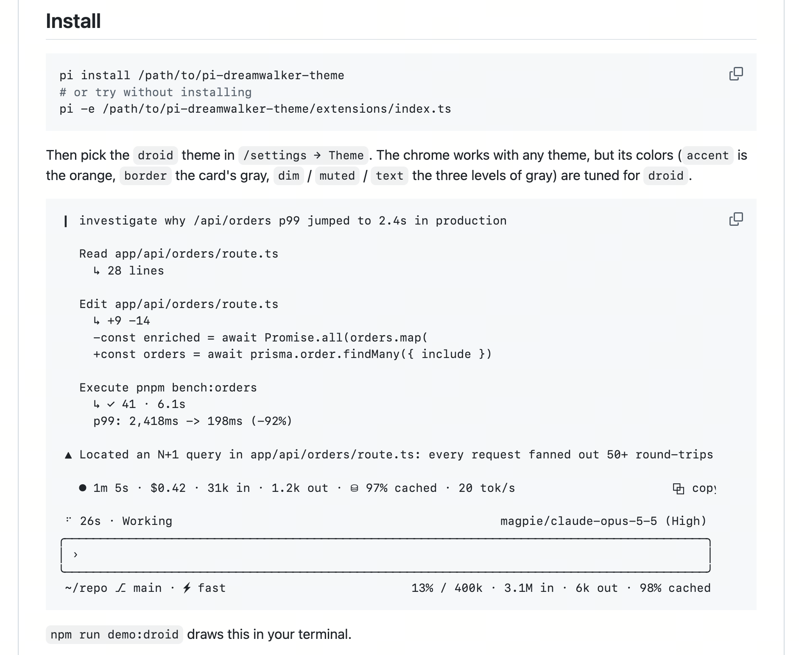
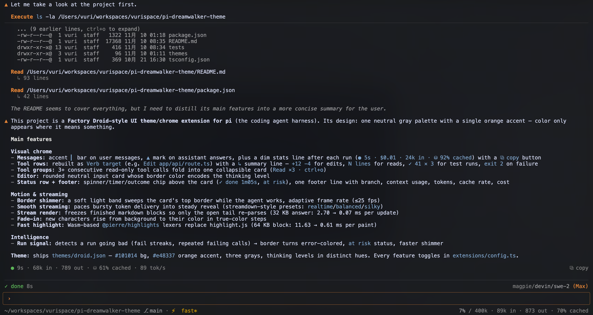

# pi-dreamwalker-theme

A quiet gray chrome for [pi](https://pi.dev), the coding agent harness: a single accent color, `Verb target` tool rows, a status row above a rounded input card, and a one-line footer.

<p>
  
  
</p>

## Features

**Visual chrome**
- `▎` accent bar on your messages, `▲` mark on assistant answers, one dim stats line after each run (`● 5s · $0.01 · 24k in · ⧉ copy`)
- Tool calls rebuilt as `Verb target` (`Edit app/api/route.ts`) with a `↳` summary line — `+12 -4` for edits, `N lines` for reads, `✓ 41 ×3` for tests, `exit 2` on failure
- 3+ consecutive read-only tool calls fold into one collapsible card (`Read ×3 · ctrl+o`)
- Rounded input card whose border color encodes the thinking level; spinner/timer/outcome chip above it (`✓ done 1m05s`, `at risk`); one footer line with branch, context usage, tokens and cost

**Motion & streaming**
- Soft light band sweeps the card's top border while the agent works (adaptive ≤25 fps)
- Smooth streaming paces bursty token delivery into a steady reveal — streamdown-style presets `realtime` / `balanced` / `silky`
- Finished markdown blocks freeze while streaming, so only the open tail re-parses (32 KB answer: 2.70 → 0.07 ms per update)
- New characters fade in from the background in true-color steps
- Wasm-based [@pierre/highlights](https://diffs.com/highlights) lexers replace highlight.js (64 KB block: 11.63 → 0.61 ms per paint)

**Intelligence**
- A run-signal state machine detects a run going bad (fail streaks, repeated failing calls) → border turns error-colored, `at risk` status, faster shimmer

Every part toggles in [`extensions/config.ts`](./extensions/config.ts) (`features`); `/reload` applies edits. Ships a bundled theme (`themes/dreamwalker.json`) — `#101014` background, `#e48337` orange accent, three grays — but the chrome works with any pi theme.

## Install

```bash
pi install git:github.com/vurihuang/pi-dreamwalker-theme

# or try it without installing
pi -e git:github.com/vurihuang/pi-dreamwalker-theme
```

Then pick the `dreamwalker` theme in `/settings → Theme`. The chrome works with any theme, but its colors (`accent` is the orange, `border` the card's gray, `dim` / `muted` / `text` the three levels of gray) are tuned for `dreamwalker`.

`npm run demo:dreamwalker` draws a demo session in your terminal.

## Design

What a session looks like, and what this package does about it:

- **Gray plus one accent.** Orange marks what is yours or active (the user bar, the assistant mark, tool verbs, the prompt); green and red mean ok and failed; a soft blue marks inline code and links. Nothing else is colored, so color means something. There is no per-tool or per-role palette.
- **Structure from type, not icons.** A tool call is a verb and its target, with one dim summary line under it. No status glyphs, rails or per-row timers.
- **Hierarchy from brightness.** Three grays (`text`, `muted`, `dim`) carry importance; thinking sits at `muted` (bright enough for the streaming fade to show on it), tool output at `muted` / `dim`.
- **Quiet chrome.** One neutral card for input, one status row above it, one footer line below it. No stats in the chat except the line under a final answer.

## What it does

| Part | Behavior |
| --- | --- |
| Messages | A `▎` bar in the accent color runs down the left of every user message, which loses its background block. The first row of each assistant answer starts with a `▲`; later paragraphs are plain, thinking is not marked. Bodies are indented under the mark. After the final answer of a run, one dim line shows `● 5s · $0.01 · 24k in · 310 out · ⛁ 92% cached · 62 tok/s` and a `⧉ copy` button (click it to copy the answer). |
| Tool rows | The call row is rebuilt from the tool and its arguments: an accent verb (`Read`, `Edit`, `Write`, `Execute`, `Grep`, `Find`, `List`, or the humanized tool name) and its target (a path, a pattern, the first line of a command, with `…` when more lines follow). A bash command's first line is syntax-highlighted. Under it, `↳` opens one summary line: `edit` → `+12 -4`; `write` → `+30`; `read` → `212 lines`; `grep` / `find` / `ls` → `N matches` / `files` / `entries`; test commands → `✓ 41 ✕ 3` (jest, vitest, pytest, node:test, cargo, from the last 1.2 KB of output); a failing command → `exit 2`; then the duration once it passes a second. A failed tool always has the line, with `↳` in the error color. A running tool and a quick, summary-less one stay a single row. The rows a tool's own renderer draws under its call line (a script's body, a write preview) stay folded until ctrl+o; `edit` is the exception, so its diff hangs under the `Edit` row. The result's output follows under a hairline, indented, and pi's trailing `Took 1.2s` is dropped (the duration is on the summary line). Tools that draw their own frame (`renderShell: "self"`) are left alone, except pi's `edit`: its status-colored card is dropped (a full-width tinted card is what terminals such as Rex, with "Match program backgrounds", take for the app background and paint across the whole pane). Each tool's own `renderCall` / `renderResult` still run. Turn the summary line off with `features.resultLine`, the whole thing with `features.toolRows`. |
| Tool groups | Three or more consecutive tool calls (not bash, edit or write) fold into one card: `Read ×3 · ctrl+o` with a `↳` row per call (its summary and duration on the right, a spinner while it runs, the first error line under a failed one) and the duration of the whole group. The header names only what needs a look (`1 running`, `1 failed`). ctrl+o or a click expands it to the tools' own rows. Turn it off with `features.toolGroup`. |
| Editor | A rounded card at pi's default height with an accent `›` prompt, under a full-width hairline (`mdHr`). Its frame is pi's own `borderColor`, which pi sets from the thinking level (the theme's `thinkingOff` … `thinkingMax`; `bashMode` after `!`), so the level reads from the frame's color; the error color while a run is at risk. Editing, IME cursor, autocomplete and keybindings are pi's `CustomEditor`. |
| Status row | One row above the card. Left: while the agent works, pi's spinner, the run timer (`4.1s`, `1m05s`) and the working message (`at risk` is appended when the run looks stuck); after a run, its outcome: `✓ done 1m05s`, `✕ failed`, `❚❚ paused 12s` (until you type again). Right: `provider/model (High)`, the level in its thinking color. When the row is narrow the message goes first. The outcome chip is `features.statusChip`. |
| Footer | One line. Left: `~/repo ⎇ branch`, the session name and extension statuses. Right: context usage (`13% / 400k`, warning past 70%, error past 90%), then session tokens, cache rate and cost. |
| Border shimmer | While the agent works, a soft band of light sweeps along the card's top border. The band is a ramp of the border color, so only OKHSL lightness moves (lighter on dark themes, darker on light ones; the hue never changes), and the sides and bottom keep the frame's color. The track dims by `trackDim` while busy and never gets closer than `minGap` to the background; a dim border (such as the bundled theme's) gets a larger swing, so the peak still sits at least `peakGap` above the background. A ticker runs only while busy and while the editor is painted: at most 25 fps (`tickMs`), slowing toward 15 fps (`maxTickMs`) when a full repaint gets expensive (`frameBudget` of a core), and it skips frames that streaming, the spinner or input already painted. The benchmark uses pi's renderer with a capturing terminal and virtual time; it measures application rendering and output bytes, excluding terminal processing and keyboard latency. It changes about two lines per frame (the status row's spinner and the border); longer sessions increase the cost of pi re-rendering the screen more often than the spinner's 12.5 fps (`npm run bench:shimmer`). Tune `shimmer` (`periodMs`, `halfWidth`, `swing`, `peakGap`, `trackDim`, `minGap`, `peakSaturation`, `tickMs`, `maxTickMs`, `frameBudget`); `npm run demo:shimmer` previews it. Turn it off with `features.borderShimmer`. |
| Smooth streaming | Providers often deliver tokens in bursts (many at once, then a 100–600 ms pause). While a message streams, its trailing text or thinking block is revealed by a pacer (after [@lobehub/streamdown](https://streamdown.lobehub.com/features/smooth-reveal)'s smoother): it tracks the chunk interval and spreads each backlog until the next chunk is due plus a reserve, so the text keeps moving between bursts; any backlog is revealed within ~`maxLagMs`. `smoothStreaming.preset` picks streamdown's three cadences: `realtime` (40 ms reserve, commits every 32 ms), `balanced` (120 / 48 ms, default) and `silky` (170 / 56 ms). Commit pacing: every commit re-parses the open tail, so the interval widens by 1 ms per `commitPerChars` characters of tail, up to `maxCommitMs` (96 ms); short blocks stay snappy, long paragraphs and lists keep the work bounded. Input that ends inside an open ```` ```html ```` fence is shown at once, for live previews (streamdown's `findOpenFenceLanguage`). When pi delivers the final message, the rest drains in ≤ 400 ms instead of being dumped in one frame; abort and errors flush at once. Earlier blocks, tool rows, and finished messages are untouched. The ticker runs only while text is buffered or fading; frames for the fade alone are at least `fadeFrameMs` apart. |
| Stream render | While a message streams, finished top-level blocks (paragraph, heading, fenced code, table, quote, rule, followed by a blank line) are frozen into cached pi `Markdown` chunks; only the open tail is lexed and wrapped per update, and earlier blocks (e.g. the thinking block above the answer) keep their rendered lines. Block boundaries come from pi's own parser, and a chunk renders exactly as inside the whole text, so streamed frames match pi's rendering line for line (tested on every prefix, at changing widths). The open tail is completed with [remend](https://www.npmjs.com/package/remend) (`**bol` → bold, `` `co `` → code, `[li` → text) so markup never flashes as source; only closing completions are used, so the final frame never jumps. `streamFade.remend` layers remend options over those defaults (streamdown's `remend` prop), e.g. `{ htmlTags: true }`. An open code fence renders as a code block from its first line. Lists and indented code are not frozen (`- a`, blank line, `- b` merges back into one list). Reference-style link definitions fall back to whole-text rendering. Measured with pi 1.5.0 and the classic look at width 120, with a thinking block (`streamRender` off → on): 2 KB answer 0.24 → 0.05 ms, 8 KB 0.67 → 0.04 ms, 32 KB 2.70 → 0.07 ms. These are local component timings, not end-to-end terminal latency. The final build is pi's own. Turn it off with `features.streamRender`. |
| Fast highlight | Code this package draws is highlighted with [@pierre/highlights](https://diffs.com/highlights) (hand-written Wasm lexers, 80 languages) instead of pi's highlight.js: the bash row's command, assistant Markdown code blocks (streaming and final, so colors never change when a message settles), and expanded `read` results (pi's layout, truncation notices and hints are kept). Scopes map onto the same `syntax*` theme tokens pi's highlight.js theme uses, so no colors are hardcoded. With `features.pierreSyntax` (default off, so the bundled theme keeps code calm) the colors come from a bundled Pierre theme instead (`pierreSyntax.dark` / `.light`, default `pierre-dark-soft` / `pierre-light-soft`), so every scope keeps its own color rather than collapsing into nine tokens; otherwise, or if the theme fails to load, the `syntax*` tokens are used. Large texts go through a small pool of incremental tokenizers that re-lex only changed lines. While a streamed message ends in an open code block, that block is rendered line by line with each line's wrapped rows cached, so a paint costs O(new lines). Measured with pi 1.5.0 and the classic look per paint of a growing ```` ```ts ```` block at width 120: 4 KB 1.17 → 0.09 ms, 16 KB 3.17 → 0.18 ms, 64 KB 11.63 → 0.61 ms (pi highlighter → fast); a 16 KB heredoc streamed in 40-char deltas: 51 ms of CPU shown plain → 35 ms highlighted live; expanding a 64 KB `.ts` read result: 12.33 → 5.57 ms. The Wasm module loads in the background at startup (~7 ms); until then, for unknown languages, or with `features.fastHighlight` off, pi's highlighter is used. Other pi views (e.g. the write tool's streaming preview) keep pi's highlighter, so token boundaries can differ slightly there. |
| Fade-in | After streamdown's [animation](https://streamdown.lobehub.com/features/animation): new characters fade in over `streamFade.fadeMs` (180 ms, streamdown's `STREAM_FADE_DURATION`). Terminals have no opacity, so a character rises from the theme's panel background (opacity 0) to its own color in `streamFade.steps` true-color steps on streamdown's `cubic-bezier(0.33, 0, 0.67, 1)` curve (a real gradient: syntax colors, bold and italic are kept, and the line's own color is restored after the run); a character whose color is a user-defined ANSI palette color is drawn faint (SGR 2) instead, and a theme without usable colors falls back to faint everywhere. Births are tracked per rendered character and staggered across the gap between paints, chained on from the previous commit's last character (so the reveal front moves as one wave) so fades never run out of order and capped at the gap plus `fadeMs` (as in streamdown) so a fast stream does not pile up invisible backlog. `streamFade.granularity` is `char` (default) or `word` (a word fades as one unit, by its newest character). Fenced code blocks skip the fade and reveal as a block (borders included), and prose after the fence fades again; table and rule borders (box drawing) never fade, so a growing table does not flicker. Needs `smoothStreaming` and `streamRender`; turn it off with `features.streamFade`. |
| Run signal | A small state machine fed by pi's events (agent start/end, tool start, tool result); it never polls and owns no timer (`features.runSignal`, tune `signal`). A run is *at risk* after `failStreak` failed tools in a row, or when one call repeats `repeats` times among the last `window` calls with two or more failures (a failing test and the same patch again and again); `recover` successes in a row clear it. At risk the card's frame turns the theme's `error` color after two blinks, the status row says `at risk`, and the border band sweeps faster (`riskPeriod`). A tool that fails live blinks its `↳` in discrete steps (lit, off, lit, off; `signal.flashStepMs`, `flashSteps`); rows rebuilt from history never blink. The frames come from four unref'd timers per failure, nothing else. Codemode child calls are ignored. |

Each part can be switched off in [`extensions/config.ts`](./extensions/config.ts) (`features`); run `/reload` after editing. The same file holds the glyphs, the card's frame, the body indent, the streaming pace (`smoothStreaming.preset`: `realtime` snappier, `silky` smoother), and the fade (`streamFade.fadeMs`, `steps`, `granularity`). Smooth streaming requests frames through the TUI captured by the editor or footer, so it needs at least one of those two features enabled.

## Theme

`themes/dreamwalker.json`, sampled from Factory's terminal UI: background `#101014`, accent orange `#e48337`, card border `#343438`, text / muted / dim `#dcdcda` / `#9a9a9d` / `#6b6b6d`, green `#5bb458`, red `#e5604d`, soft blue `#7ca1c9`. Syntax tokens stay in the same restrained range (lavender keywords, blue functions, sage strings, amber numbers). The thinking levels step through distinct hues so the card's frame tells them apart: off `#4b4b50`, minimal `#6b6b6d`, low blue, medium teal, high lavender, xhigh amber, max the accent orange.

## Design notes

- **pi-native.** It uses the public extension API where one exists: `setEditorComponent` with a `CustomEditor` subclass, `setFooter`, and `registerToolRenderer` (which wraps each tool's renderers). Only the built-in message components have no hook, so `UserMessageComponent.rebuild` and `AssistantMessageComponent.updateContent` are wrapped. The originals live in a global registry, so `/reload` replaces the wrap instead of stacking it, and quitting restores them.
- **Performance.** All decoration happens when a component is built or updated, never per frame. Added rows are cached components, invalidated on theme change. Run stats come from extension events (delivered before pi renders and persists a message) and from one O(n) branch index per session or tree change. The footer recomputes totals only when the session leaf or the model changes. Measured with pi 1.5.0 at width 120: editor ~2 µs per frame, footer ~1 µs.
- **Theme first.** No hex values in the extensions. Color is applied at render time from the theme pi passes in, so theme switches and hot reloads take effect without a restart.

## Development

Development dependencies are pinned to pi 1.5.0. When pi loads this extension, it supplies its own host modules; the `"*"` peer ranges follow pi's package convention.

```bash
npm install
npm run check          # tsc + node --test (unit + render tests against the real pi 1.5.0 components)
npm run bench
npm run demo:dreamwalker # a transcript, the card and the footer through four moments of a run
HTML=/tmp/chrome.html node bench/dreamwalker-demo.ts   # the same as a page, for screenshots
```

Visual language inspired by [Factory](https://factory.com/product/cli)'s terminal UI. No code is copied; this package is pi-tui components.
